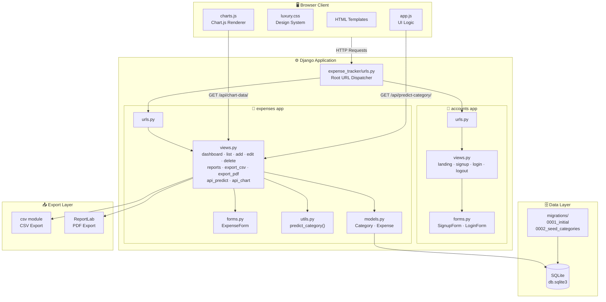
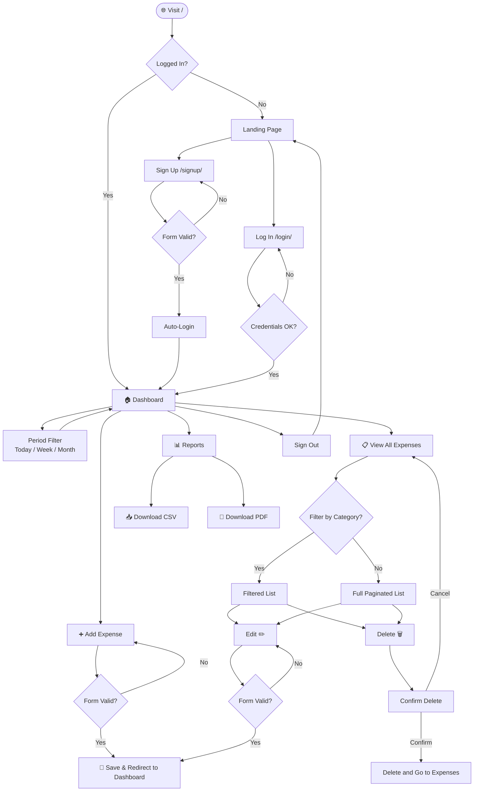
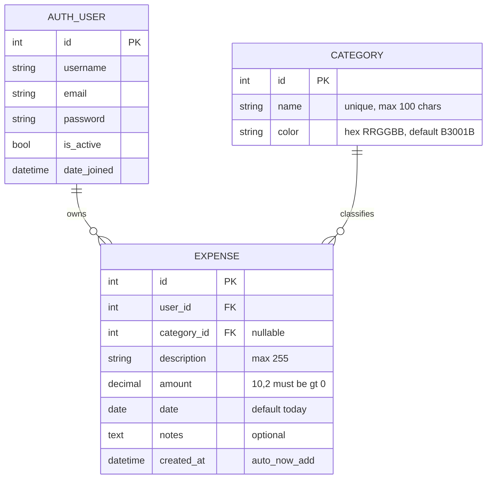
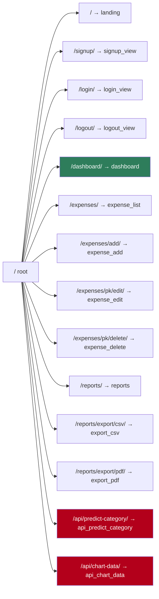
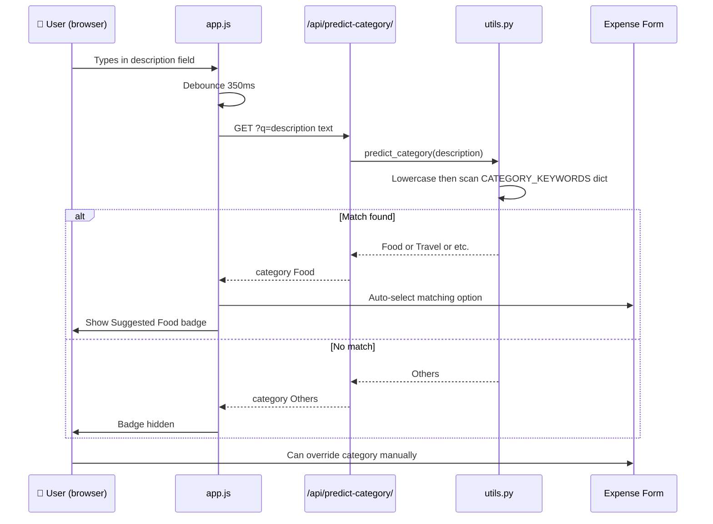
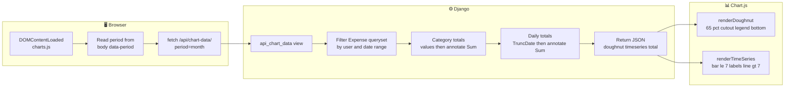
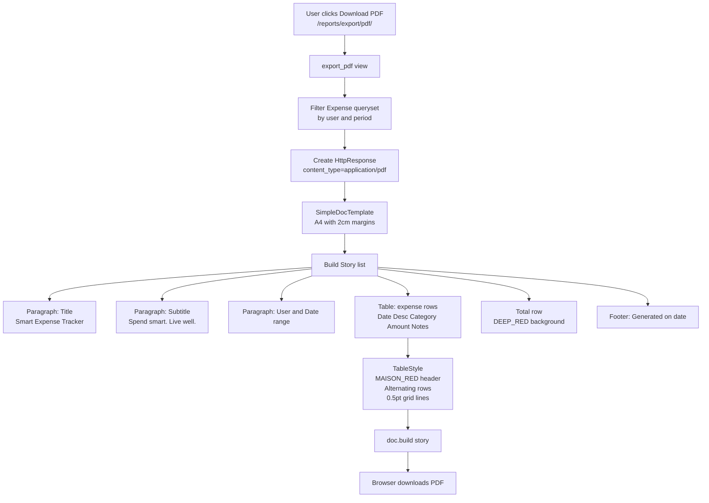
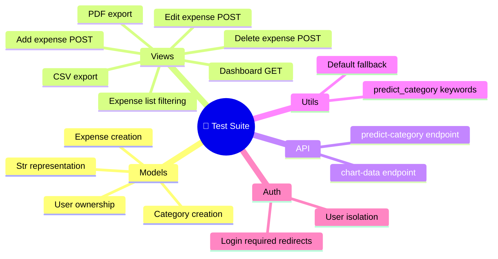
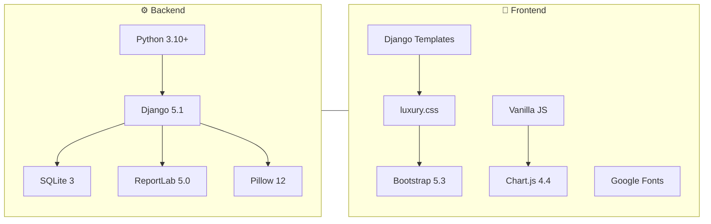

<div align="center">

#  Maison Rouge — Smart Expense Tracker

> **Spend smart. Live well.**  
> A luxury-grade personal expense tracker built with Django 5, Chart.js, and ReportLab — featuring AI-powered category prediction, beautiful analytics, and one-click PDF/CSV exports.

[](https://docs.djangoproject.com/)
[](https://www.python.org/)
[](https://www.chartjs.org/)
[](https://www.reportlab.com/)
[](https://getbootstrap.com/)
[](https://www.sqlite.org/)

---

</div>

## 📋 Table of Contents

- [✨ Features](#-features)
- [🗂️ Project Structure](#️-project-structure)
- [🏗️ Architecture Overview](#️-architecture-overview)
- [🔄 User Flow](#-user-flow)
- [🗄️ Database Schema](#️-database-schema)
- [🌐 URL Map](#-url-map)
- [🧠 AI Category Prediction Flow](#-ai-category-prediction-flow)
- [📊 Chart Data Pipeline](#-chart-data-pipeline)
- [📄 PDF Export Pipeline](#-pdf-export-pipeline)
- [🚀 Getting Started](#-getting-started)
- [⚙️ Configuration](#️-configuration)
- [🧪 Running Tests](#-running-tests)
- [🛠️ Tech Stack](#️-tech-stack)
- [📁 Key Files Reference](#-key-files-reference)

---

## ✨ Features

| Feature | Description |
|---|---|
| 🔐 **Auth System** | Signup, Login, Logout with Django's built-in auth + session storage |
| 📊 **Dashboard** | Hero card, stat chips, doughnut + bar/line charts — all period-filtered |
| ➕ **Expense CRUD** | Add, Edit, Delete with floating-label form UI and validation |
| 🤖 **AI Prediction** | Keyword-based live category suggestion as you type (debounced, 350ms) |
| 📅 **Period Filters** | Today / This Week / This Month — segmented pill control |
| 📂 **Category Filter** | Filter expense list by category with inline dropdown |
| 📄 **CSV Export** | One-click download of filtered expenses as `.csv` |
| 🖨️ **PDF Export** | Branded ReportLab PDF with red header, alternating rows, summary total |
| 📱 **Responsive UI** | Mobile-first bottom tab bar + desktop FAB + glassmorphism cards |
| 🎨 **Design System** | 1,300+ line `luxury.css` — CSS custom properties, spring animations, floating labels |
| ♿ **Accessibility** | ARIA roles, labels, keyboard navigation, reduced-motion support |

---

## 🗂️ Project Structure

```
mo3-2/                              ← project root
│
├── manage.py                       ← Django management CLI
├── requirements.txt                ← pip dependencies
├── db.sqlite3                      ← SQLite database (dev)
│
├── expense_tracker/                ← Django project config
│   ├── settings.py                 ← All settings (DB, auth, static, TZ)
│   ├── urls.py                     ← Root URL dispatcher
│   └── wsgi.py                     ← WSGI entry point
│
├── accounts/                       ← Auth app
│   ├── views.py                    ← landing, signup, login, logout
│   ├── urls.py                     ← /, /signup/, /login/, /logout/
│   ├── forms.py                    ← SignupForm, LoginForm
│   └── templates/accounts/
│       ├── landing.html
│       ├── signup.html
│       └── login.html
│
├── expenses/                       ← Core app
│   ├── models.py                   ← Category, Expense models
│   ├── views.py                    ← All 9 views + 2 API endpoints
│   ├── urls.py                     ← 9 URL patterns
│   ├── forms.py                    ← ExpenseForm (with validation)
│   ├── utils.py                    ← predict_category() keyword engine
│   ├── admin.py                    ← Django admin registration
│   ├── tests.py                    ← Unit + integration tests
│   └── migrations/
│       ├── 0001_initial.py         ← Category + Expense tables
│       └── 0002_seed_categories.py ← Seeds 9 default categories
│
├── templates/                      ← Global template root
│   ├── base.html                   ← Shared layout (nav, toast, tab bar)
│   └── expenses/
│       ├── dashboard.html
│       ├── expense_list.html
│       ├── expense_form.html       ← Add & Edit (shared)
│       ├── expense_confirm_delete.html
│       └── reports.html
│
└── static/
    ├── css/
    │   └── luxury.css              ← Maison Rouge design system (1,362 lines)
    └── js/
        ├── app.js                  ← UI interactions (segmented, toasts, forms)
        └── charts.js               ← Chart.js doughnut + timeseries renderer
```

---

## 🏗️ Architecture Overview



---

## 🔄 User Flow



---

## 🗄️ Database Schema



### 🌱 Seeded Categories

| # | Category | Hex Color |
|---|---|---|
| 1 | 🍕 Food | `#E63946` |
| 2 | 🛒 Groceries | `#2E7D5B` |
| 3 | 🚕 Travel | `#F59E0B` |
| 4 | 💊 Health | `#7C3AED` |
| 5 | 🎬 Entertainment | `#DB2777` |
| 6 | 📚 Education | `#0891B2` |
| 7 | ⚡ Bills | `#B3001B` |
| 8 | 🛍️ Shopping | `#EA580C` |
| 9 | 📦 Others | `#6B6B6B` |

---

## 🌐 URL Map



| Method | Endpoint | View | Auth Required |
|---|---|---|---|
| `GET` | `/` | `landing` | ❌ |
| `GET POST` | `/signup/` | `signup_view` | ❌ |
| `GET POST` | `/login/` | `login_view` | ❌ |
| `POST` | `/logout/` | `logout_view` | ✅ |
| `GET` | `/dashboard/` | `dashboard` | ✅ |
| `GET` | `/expenses/` | `expense_list` | ✅ |
| `GET POST` | `/expenses/add/` | `expense_add` | ✅ |
| `GET POST` | `/expenses/<pk>/edit/` | `expense_edit` | ✅ |
| `GET POST` | `/expenses/<pk>/delete/` | `expense_delete` | ✅ |
| `GET` | `/reports/` | `reports` | ✅ |
| `GET` | `/reports/export/csv/` | `export_csv` | ✅ |
| `GET` | `/reports/export/pdf/` | `export_pdf` | ✅ |
| `GET` | `/api/predict-category/` | `api_predict_category` | ❌ |
| `GET` | `/api/chart-data/` | `api_chart_data` | ✅ |

---

## 🧠 AI Category Prediction Flow



### Keyword Dictionary (excerpt)

```python
CATEGORY_KEYWORDS = {
    'Food':          ['pizza', 'burger', 'swiggy', 'zomato', 'restaurant', ...],
    'Groceries':     ['bigbasket', 'blinkit', 'zepto', 'dmart', 'milk', ...],
    'Travel':        ['uber', 'ola', 'petrol', 'metro', 'flight', 'bus', ...],
    'Health':        ['doctor', 'medicine', 'gym', 'hospital', 'pharmacy', ...],
    'Entertainment': ['netflix', 'spotify', 'movie', 'concert', 'gaming', ...],
    'Bills':         ['electricity', 'rent', 'wifi', 'emi', 'insurance', ...],
    'Shopping':      ['amazon', 'flipkart', 'myntra', 'clothes', 'shoes', ...],
    'Education':     ['udemy', 'coursera', 'book', 'tuition', 'college', ...],
}
```

---

## 📊 Chart Data Pipeline



---

## 📄 PDF Export Pipeline



---

## 🚀 Getting Started

### Prerequisites

- Python **3.10+**
- `pip`
- `git`

### 1 — Clone the repository

```bash
git clone <your-repo-url>
cd mo3-2
```

### 2 — Create & activate a virtual environment

```bash
# Windows
python -m venv venv
venv\Scripts\activate

# macOS / Linux
python -m venv venv
source venv/bin/activate
```

### 3 — Install dependencies

```bash
pip install -r requirements.txt
```

### 4 — Apply migrations & seed categories

```bash
python manage.py migrate
```

> The migration `0002_seed_categories` automatically seeds 9 default categories.

### 5 — Create a superuser *(optional — for Django admin panel)*

```bash
python manage.py createsuperuser
```

### 6 — Run the development server

```bash
python manage.py runserver
```

Open **http://127.0.0.1:8000/** in your browser — you should see the Maison Rouge landing page. Sign up for a new account and start tracking!

---

## ⚙️ Configuration

All settings live in `expense_tracker/settings.py`:

| Setting | Default Value | Description |
|---|---|---|
| `DEBUG` | `True` | Disable in production |
| `TIME_ZONE` | `Asia/Kolkata` | IST — change to your TZ |
| `LANGUAGE_CODE` | `en-us` | Localisation |
| `CURRENCY_SYMBOL` | `₹` | Displayed across templates |
| `LOGIN_URL` | `/login/` | Redirect for `@login_required` |
| `LOGIN_REDIRECT_URL` | `/dashboard/` | After successful login |
| `LOGOUT_REDIRECT_URL` | `/` | After logout |
| `DATABASE.ENGINE` | `sqlite3` | Switch to `postgresql` for production |
| `STATIC_URL` | `/static/` | Static files URL prefix |
| `MESSAGE_STORAGE` | `session.SessionStorage` | Toast message backend |

---

## 🧪 Running Tests

```bash
python manage.py test expenses
```

The test suite in `expenses/tests.py` covers:



---

## 🛠️ Tech Stack



| Layer | Technology | Version |
|---|---|---|
| Web Framework | Django | `>=5.0, <6.0` |
| Language | Python | `3.10+` |
| Database | SQLite | built-in |
| PDF Generation | ReportLab | `>=4.0` |
| Image Processing | Pillow | `>=10.0` |
| Charts | Chart.js | `4.4.0` (CDN) |
| CSS Framework | Bootstrap | `5.3.2` (CDN, grid only) |
| Typography | Google Fonts | Inter + Playfair Display |

---

## 📁 Key Files Reference

| File | Lines | Purpose |
|---|---|---|
| `expense_tracker/settings.py` | 106 | Project-wide settings |
| `expense_tracker/urls.py` | 21 | Root URL configuration |
| `expenses/models.py` | 66 | `Category` and `Expense` models |
| `expenses/views.py` | 551 | All views + API endpoints |
| `expenses/forms.py` | 69 | `ExpenseForm` with amount validation |
| `expenses/utils.py` | 90 | `predict_category()` keyword engine |
| `expenses/urls.py` | 28 | All URL patterns for the expenses app |
| `accounts/views.py` | 83 | Auth views: landing, signup, login, logout |
| `templates/base.html` | 146 | Shared layout: navbar, toast, tab bar, FAB |
| `templates/expenses/dashboard.html` | 173 | Main dashboard template |
| `static/css/luxury.css` | 1,362 | Maison Rouge design system |
| `static/js/app.js` | 265 | Segmented control, toasts, AI badge, forms |
| `static/js/charts.js` | 202 | Chart.js doughnut + timeseries renderer |

---

## 🚀 Deploying to Vercel

This repository is pre-configured for seamless deployment on [Vercel](https://vercel.com):

1. **Import to Vercel**:
   - Log in to [vercel.com](https://vercel.com) and click **"Add New Project"**.
   - Select and import your GitHub repository: `akashvoffi-design/Smart-Expense-Tracker`.

2. **Configure Environment Variables** (in Vercel Settings > Environment Variables):
   - `SECRET_KEY`: A secure random secret key.
   - `DEBUG`: `False`
   - `ALLOWED_HOSTS`: `*` (or your Vercel domain e.g. `.vercel.app`)
   - `DATABASE_URL`: *(Recommended for production)* PostgreSQL connection string (from Neon, Supabase, or Railway). If omitted, an ephemeral SQLite database in `/tmp` is automatically initialized for demonstration.

3. **Deploy**:
   - Click **Deploy**. Vercel will execute `build_files.sh`, collect static assets with WhiteNoise, and serve the WSGI application serverlessly.

---

<div align="center">

**Made with ❤️ and ₹ in mind**

*Maison Rouge — Smart Expense Tracker*

`Spend smart. Live well.`

</div>

